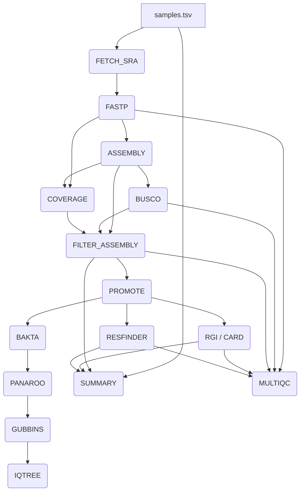

# blaCTX Pipeline

A Nextflow workflow for reproducible *Klebsiella pneumoniae* genome analysis: it downloads reads, assembles and quality-filters genomes, screens for antimicrobial resistance genes (with a focus on **blaCTX-M-15**) and builds a recombination-free phylogeny.

## What it does

1. **Fetch & trim**: downloads reads from SRA/ENA and runs QC and trimming (fastp).
2. **Assemble & QC**: Shovill/SKESA (paired-end) or SPAdes `--isolate` (single-end), then BUSCO and read-depth coverage.
3. **Filter**: keeps assemblies that pass completeness, coverage and contig thresholds.
4. **AMR screening**: RGI/CARD and ResFinder on passing assemblies.
5. **Phylogeny**: Bakta, Panaroo, Gubbins and IQ-TREE (needs at least 4 passing genomes, otherwise skipped).
6. **Report**: cohort summary (`TSV`/`XLSX`) and a MultiQC report.



## Requirements

- Linux or WSL2 (x86_64)
- [Nextflow](https://www.nextflow.org/) >= 26.04.6 (needs Java 17+)
- Conda/Mamba **or** Docker/Singularity
- Internet access (read download, first-time environment/image setup) and several GB of disk

## Quick start

```bash
git clone https://github.com/hasibulhossainsau-netizen/blaCTX_pipeline
cd blaCTX_pipeline

bin/setup_databases.sh                       # download CARD, ResFinder, BUSCO, Bakta into resources/

export NCBI_EMAIL="you@example.org"          # needed for read download
export NCBI_API_KEY="..."                    # optional, raises rate limits

nextflow run main.nf -profile test -stub-run # optional smoke test (no downloads)

nextflow run main.nf -profile docker -resume \
  --samples config/samples.tsv \
  --results results \
  --threads 8
```

Use `-profile conda` instead of `docker` if you prefer conda environments.

## Profiles

| Profile | Use |
| :--- | :--- |
| `conda`, `mamba`, `micromamba` | One conda environment per process (built on first use) |
| `docker` | Docker containers (public biocontainers plus a small helper image) |
| `singularity` | Same images via Singularity/Apptainer |
| `test` | 2 CPUs, writes to `results_test/`; combine with `-stub-run` |


## Input

`config/samples.tsv` is tab-separated:

| Column | Meaning |
| :--- | :--- |
| `sample_id` (or `Run`) | Sample name |
| `sra_accession` (or `Run`) | Accession to download |
| `source_type` | `SRA_PE`/`PE` (paired-end) or `SRA_SE`/`SE` (single-end); both can be mixed |

Any other columns (e.g. `geo_loc_name`, `isolation_source`) are carried into the final summary. See `config/README.md`.

## Reference databases

`bin/setup_databases.sh` installs everything (`-d "card busco"` selects, `-f` refreshes, `-r DIR` changes the target).

| Resource | Version | Path | Override |
| :--- | :--- | :--- | :--- |
| CARD | v4.0.2 | `resources/card_data/card.json` | `--card_json` |
| ResFinder DB | commit `eecf0aa` | `resources/resfinder/db_resfinder` | `--resfinder_db` |
| Bakta DB | v6.0 (light or full) | `resources/db-light` | `--bakta_db` |
| BUSCO | `enterobacterales_odb10` | `resources/busco_db/enterobacterales_odb10` | `--busco_db` |

> Bakta is pinned to 1.11.4. Newer versions need a newer AMRFinderPlus DB than the one in Bakta DB v6.0. Update the tool and DB together.

## Main parameters

Set with `--name value`; all defaults are in `nextflow.config`.

| Parameter | Default | Description |
| :--- | :--- | :--- |
| `samples` | `config/samples.tsv` | Sample manifest |
| `results` | `results` | Output directory |
| `threads` | `10` | CPUs per process |
| `target_gene` | `blaCTX-M-15` | Gene flagged in the summary |
| `busco_min` | `95` | Minimum BUSCO completeness (%) |
| `coverage_min` | `50` | Minimum read depth (x) |
| `max_contigs` | `200` | Maximum contig count |
| `min_contig_len` | `500` | Minimum contig length (bp) |
| `min_phylo_samples` | `4` | Minimum passing genomes for the phylogeny |
| `iqtree_bootstraps` | `1000` | Ultrafast bootstrap replicates |
| `delete_intermediates` | `true` | Delete reads/scratch to save disk. **Set to `false` if you want `-resume` to work** |

Other options (fastp trimming, Panaroo, Gubbins, IQ-TREE model, RGI, ResFinder, SPAdes, genome size) are listed in `nextflow.config`.

## Outputs

| Directory | Contents |
| :--- | :--- |
| `01_qc/` | fastp reports and `multiqc/multiqc_report.html` |
| `02_assembly/` | Assemblies and coverage |
| `03_busco/` | BUSCO summaries |
| `04_filtered_assemblies/` | Filter status and passing assemblies |
| `05_amr/` | RGI and ResFinder results |
| `06_metadata/` | `cohort_metadata_summary.tsv` / `.xlsx` |
| `07_phylogenomics/` | Bakta annotations, Panaroo pangenome, Gubbins alignment, IQ-TREE tree (`iqtree.treefile`) |

Run reports (timeline, trace) are in `results/pipeline_info/`. Assembly metrics vary slightly between runs, so compare QC status and `blaCTX-M-15` calls rather than exact numbers.

## Repository layout

```
main.nf              workflow
nextflow.config      parameters, profiles, containers
config/              sample manifest and docs
bin/                 database setup script
workflow/envs/       conda environments
workflow/scripts/    Python utilities (each has --help)
containers/helper/   helper image Dockerfile
```

## Troubleshooting

- **Panaroo "Invalid gene sequence!"**: caused by selenocysteine CDS in Bakta output; the pipeline already runs Panaroo with `--remove-invalid-genes`.
- **`-resume` re-runs fetch/fastp**: run with `--delete_intermediates false`.

## Citation and license

If you use this pipeline, please cite it (see [CITATION.cff](CITATION.cff) or GitHub's "Cite this repository" button) along with the tools it wraps: Nextflow, fastp, MultiQC, Shovill, SKESA, SPAdes, BUSCO, RGI/CARD, ResFinder, Bakta, Panaroo, Gubbins and IQ-TREE.

Released under the [MIT License](LICENSE).
