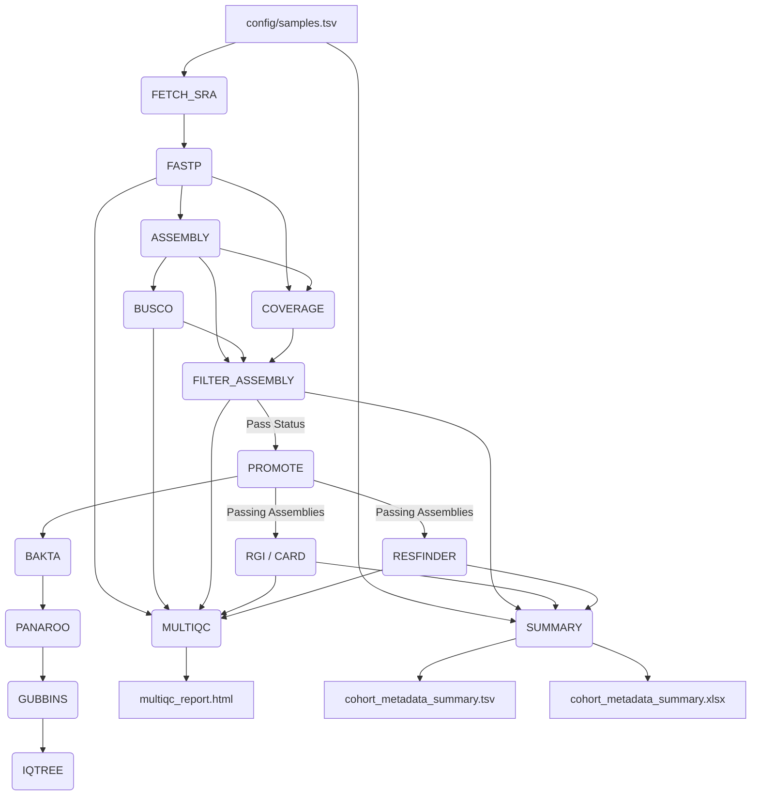

# blaCTX Pipeline

Nextflow workflow for reproducible *Klebsiella pneumoniae* whole-genome
analysis, with emphasis on assembly quality control and detection of
extended-spectrum beta-lactamase genes, including **blaCTX-M-15**.

## Overview

The pipeline automates raw read processing, assembly, quality filtering, and dual-tool AMR screening:
1. **Fetch & Preprocess:** Retrieves SRA/ENA reads and performs QC and adapter/quality trimming in one step (fastp).
2. **Assemble & QC:** Assembles genomes (Shovill/SKESA for paired-end reads, SPAdes `--isolate` for single-end reads) and evaluates quality (BUSCO, read-depth coverage).
3. **Filter:** Filters assemblies based on completeness, coverage, and contig thresholds.
4. **AMR Screening:** Screens passing assemblies using **RGI/CARD** and **ResFinder**.
5. **Phylogenomics:** Annotates passing assemblies (Bakta), builds a core-gene pangenome alignment (Panaroo), removes recombination (Gubbins) and infers a maximum-likelihood tree (IQ-TREE).
6. **Report:** Generates a unified cohort-level metadata summary (`TSV` / `XLSX`) and a MultiQC report aggregating fastp, BUSCO, assembly and AMR-screening metrics.



## Prerequisites

- **OS:** Linux / WSL2 (x86_64)
- **Nextflow** >= 26.04.6 (tested with 26.04.6 and latest-stable in CI), which needs Java 17+
- **Conda or Mamba** (or **Docker / Singularity**, see [Profiles](#profiles)). With conda, each process builds its own environment from `workflow/envs/*.yaml` on first use, (including `fastp` and `MultiQC`), so the first run needs internet access and several GB of disk.
- **Network access** to ENA/NCBI for read download (`FETCH_SRA`)
- A free NCBI e-mail (and optionally an API key) for the Entrez fallback

## Directory structure

```
.
├── main.nf                    # Nextflow DSL2 workflow
├── nextflow.config            # Default params, process directives, profiles
├── config/
│   ├── config.yaml            # Reference settings/thresholds (not read by main.nf)
│   ├── README.md              # Manifest column documentation
│   └── samples.tsv            # Example manifest (5 PE + 3 SE runs)
├── bin/
│   └── setup_databases.sh     # Downloads CARD, ResFinder, BUSCO and Bakta into resources/
├── containers/helper/         # Dockerfile for the python/pandas/sra-tools helper image
├── workflow/
│   ├── envs/                  # Conda environment YAMLs
│   └── scripts/               # Python utilities (each supports --help)
├── resources/                 # Local reference DBs (not tracked in git)
├── .github/workflows/test.yml # CI: config parsing + `-stub-run` on push/PR
└── results/                   # Pipeline outputs
```

## Setup

1. **Clone the repository**
   ```bash
   git clone <repo-url> blaCTX_pipeline && cd blaCTX_pipeline
   ```
2. **Install the reference databases** under `resources/`: run `bin/setup_databases.sh` (see below).
3. **Export NCBI credentials** for read download:
   ```bash
   export NCBI_EMAIL="you@example.org"
   export NCBI_API_KEY="replace-with-a-secret"   # optional but raises rate limits
   ```
4. **Smoke-test the wiring** (no tools or downloads, uses stub blocks):
   ```bash
   nextflow run main.nf -profile test -stub-run
   ```

## Reference databases

Download everything with one command (idempotent; `-f` refreshes, `-d "card busco"` selects, `-r DIR` changes the target):

```bash
bin/setup_databases.sh
```

| Resource | Version | Expected path | Override with |
| :--- | :--- | :--- | :--- |
| **CARD** | v4.0.2 | `resources/card_data/card.json` | `--card_json` |
| **ResFinder DB** | commit [`eecf0aa`](https://bitbucket.org/genomicepidemiology/resfinder_db) (Jan 2026) | `resources/resfinder/db_resfinder` | `--resfinder_db` |
| **Bakta DB** | v6.0 (full or light) | `resources/db-light` | `--bakta_db` |
| **BUSCO lineage** | `enterobacterales_odb10` (OrthoDB v10.1) | `resources/busco_db/enterobacterales_odb10` | `--busco_db` |

```text
resources/
├── busco_db/
│   └── enterobacterales_odb10/   # lineage (BUSCO runs --offline)
├── db-light/          # from `bakta_db download --output resources --type light  (or full)`
├── card_data/         # card.json
└── resfinder/
    └── db_resfinder/
```

## Sample manifest

`config/samples.tsv` is tab-separated. The workflow uses these columns:

| Column | Required | Meaning |
| :--- | :--- | :--- |
| `sample_id` or `Run` | yes | Sample name (falls back to the SRA run accession) |
| `sra_accession` or `Run` | yes | Accession to download |
| `source_type` | yes | Read layout: `SRA_PE`/`PE` (paired-end) or `SRA_SE`/`SE` (single-end). Anything else stops the run with an error. Paired and single-end samples can be mixed in one manifest |

All other columns (e.g. `geo_loc_name`, `isolation_source`, `HOST`) are carried into the final cohort summary. See `config/README.md`. The bundled example lists 8 ENA-verified *K. pneumoniae* runs (5 paired-end, 3 single-end).

## Running

```bash
nextflow run main.nf -profile conda -resume \
  --samples config/samples.tsv \
  --results results \
  --threads 8 \
  --target_gene blaCTX-M-15
```

### Profiles

| Profile | Purpose |
| :--- | :--- |
| `conda` | Per-process conda environments (the supported way to run) |
| `mamba` | Same, resolving environments with mamba (faster) |
| `micromamba` | Same, using micromamba (when `conda`/`mamba` are not installed) |
| `docker` | Docker containers (pinned `quay.io/biocontainers` images, set per process in `nextflow.config`) |
| `singularity` | Singularity/Apptainer containers (same images; cached in `.singularity_cache/`) |
| `test` | Local executor, 2 CPUs, writes to `results_test/`; combine with `-stub-run` |

**Containers.** Profiles can be combined, e.g. `-profile docker`. Tool images are public biocontainers. `FETCH_SRA`, `FILTER_ASSEMBLY`, `PROMOTE` and `SUMMARY` need pandas/openpyxl/sra-tools, which no biocontainer bundles, so they use a helper image (`--container_helper`, default `ghcr.io/hasibulhossainsau-netizen/blactx-helper:0.1.0`). Build and push it once from `containers/helper/Dockerfile`:

```bash
docker build -t ghcr.io/<owner>/blactx-helper:0.1.0 containers/helper && docker push ghcr.io/<owner>/blactx-helper:0.1.0
```

`projectDir` is mounted into the containers; databases passed via `--card_json`, `--resfinder_db`, `--busco_db` or `--bakta_db` from outside the repo need an extra bind mount (`docker.runOptions` / `singularity.runOptions`). The container profiles have not been run end-to-end yet.

### Parameters

All defaults live in `nextflow.config` and can be overridden on the command line as `--name value`.

| Parameter | Default | Description |
| :--- | :--- | :--- |
| `samples` | `config/samples.tsv` | Sample manifest |
| `results` | `results` | Output directory |
| `threads` | `10` | CPUs per process |
| `delete_intermediates` | `true` | Delete reads and assembler/BUSCO/Bakta scratch dirs once consumed to save disk. Side effect: `-resume` re-runs `FETCH_SRA`/`FASTP` |
| `target_gene` | `blaCTX-M-15` | Gene flagged in the cohort summary |
| `card_json`, `resfinder_db`, `busco_db` | under `resources/` | Database locations |
| `genome_size` | `5.5M` | Expected genome size given to Shovill (`--gsize`, paired-end only) |
| `spades_memory` | `8` | Memory limit in GB for SPAdes (single-end assembly) |
| `bakta_db` | `resources/db-light` | Bakta database directory |
| `container_helper` | `ghcr.io/hasibulhossainsau-netizen/blactx-helper:0.1.0` | Helper image for pandas/sra-tools steps (docker/singularity profiles only) |
| `panaroo_mode` | `strict` | Panaroo `--clean-mode` (`strict`, `moderate`, `sensitive`) |
| `panaroo_core_threshold` | `0.98` | Gene presence fraction defining the core genome |
| `gubbins_tree_builder` | `fasttree` | Tree builder used inside Gubbins |
| `gubbins_iterations` | `5` | Gubbins iterations |
| `iqtree_model` | `MFP+ASC` | IQ-TREE model (ModelFinder Plus; `+ASC` corrects ascertainment bias, required because the Gubbins output contains only variable sites) |
| `iqtree_bootstraps` | `1000` | Ultrafast bootstrap replicates (`-bb`) |
| `iqtree_seed` | `42` | IQ-TREE random seed |
| `min_phylo_samples` | `4` | Minimum passing genomes; below this Panaroo/Gubbins/IQ-TREE are skipped |
| `rgi_aligner` | `BLAST` | RGI alignment tool |
| `resfinder_species` | `Klebsiella` | ResFinder species |
| `fastp_min_quality` | `20` | fastp sliding-window mean quality cut (front and tail) |
| `fastp_window_size` | `4` | fastp sliding-window size |
| `fastp_min_length` | `50` | Minimum read length kept after trimming |
| `busco_lineage` | `enterobacterales_odb10` | Lineage name used to label BUSCO results in MultiQC |
| `busco_min` | `95` | Minimum BUSCO completeness (%) |
| `coverage_min` | `50` | Minimum read depth (x) |
| `max_contigs` | `200` | Maximum contig count |
| `min_contig_len` | `500` | Minimum contig length (bp) |

Run reports (timeline, report, trace) are written to `results/pipeline_info/`.

### Standalone scripts

Every script in `workflow/scripts/` has a `--help` page:

```bash
python workflow/scripts/estimate_coverage.py --help
python workflow/scripts/validate_assemblies.py {filter-one,promote,build-summary} --help
python workflow/scripts/amr_screening.py {rgi,resfinder,parse-hits} --help
python workflow/scripts/fetch_genomes.py --help
python workflow/scripts/make_multiqc_custom.py --help
python workflow/scripts/parse_selection_results.py --help   # not used by main.nf yet
```

> `config/config.yaml` is a reference file that `main.nf` does not read; the unimplemented selection-analysis settings are commented out under its `future_work` block. Parameters that `main.nf` consumes come from `nextflow.config`.

## Follow-Along Example & Expected Output

To test the pipeline with the provided example manifest (`config/samples.tsv`):

1. **Run the pipeline** using the command in [Running](#running).
2. **Verify Results:** Upon completion, the pipeline generates the primary aggregated summary files under `results/06_metadata/`:
   - `results/06_metadata/cohort_metadata_summary.tsv`
   - `results/06_metadata/cohort_metadata_summary.xlsx`

Reference output from an earlier 10-sample, all-paired-end manifest is archived in `results/expected_output_legacy_10sample/` for reference only; it does not match the bundled `config/samples.tsv`, and a refreshed reference set will be added after a clean full run. Assembly-derived columns (contig counts, lengths, coverage) can vary slightly between runs, so compare QC status and `blaCTX-M-15` calls rather than exact values.

## Outputs

| Directory | Contents |
|---|---|
| `results/01_qc/fastp/` | Per-sample fastp HTML and JSON reports (raw and trimmed reads are intermediates and are not published) |
| `results/01_qc/multiqc/` | `multiqc_report.html` and `multiqc_report_data/` (fastp, BUSCO, assembly QC, target-gene hits) |
| `results/02_assembly/` | Per-sample assemblies and coverage files |
| `results/03_busco/` | BUSCO short summaries |
| `results/04_filtered_assemblies/` | Filter status JSON and promoted assemblies |
| `results/05_amr/rgi/` | RGI tabular and JSON outputs |
| `results/05_amr/resfinder/` | ResFinder outputs |
| `results/06_metadata/` | Cohort TSV and XLSX summary |
| `results/07_phylogenomics/bakta/` | Per-sample `.gff3`, `.gbk` (Bakta GenBank output) and `.faa` |
| `results/07_phylogenomics/panaroo/` | Pangenome outputs incl. `core_gene_alignment.aln`, `gene_presence_absence.csv`, `final_graph.gml` |
| `results/07_phylogenomics/gubbins/` | `gubbins.filtered_polymorphic_sites.fasta` (recombination-filtered SNP alignment), recombination GFF and trees |
| `results/07_phylogenomics/iqtree/` | `iqtree.treefile` (Newick, with UFBoot support), `iqtree.iqtree` report, log |

Panaroo runs with `--remove-invalid-genes`: Bakta GFF3s contain selenocysteine CDS (formate dehydrogenase, in-frame TGA) that Panaroo otherwise reads as internal stops and aborts with `Invalid gene sequence!`. The IQ-TREE environment is pinned to `iqtree>=2.2,<3` because IQ-TREE 3 no longer ships the `iqtree2` executable that `IQTREE` calls.

Phylogenomics runs on the genomes that pass the Step 04 filter and needs at least `min_phylo_samples` (4) of them; with fewer, those steps are skipped (a warning is logged) without error.


## Citation & License 

This project is licensed under the MIT License. See the [LICENSE](LICENSE) file for details.

Please cite Nextflow, fastp, MultiQC, Shovill, SKESA, SPAdes, BUSCO, RGI/CARD, ResFinder, Bakta, Panaroo, Gubbins, and IQ-TREE when publishing results.

